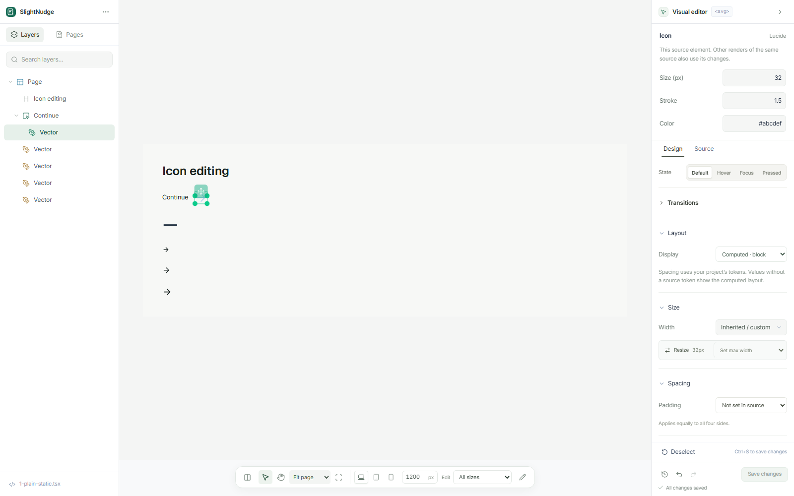
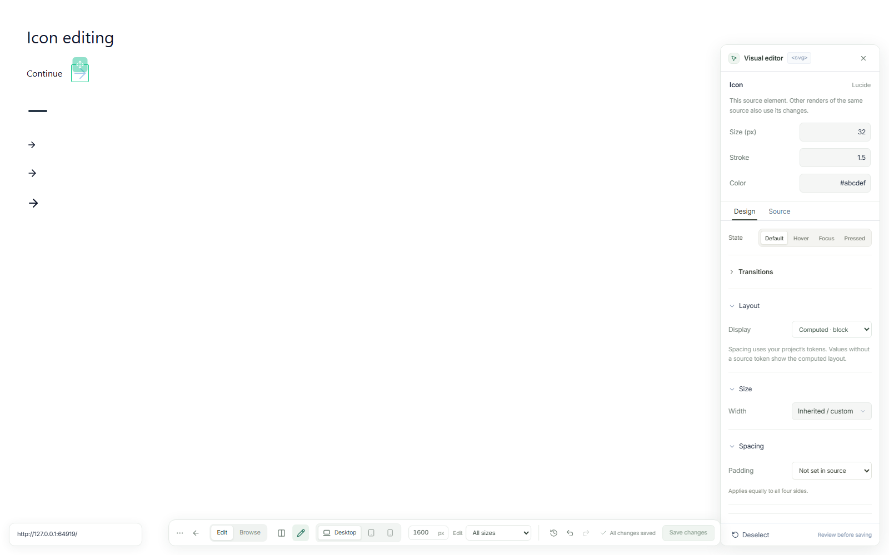

# Icon appearance editing

This milestone adds source-backed icon size, stroke width and stroke color to the
shared Studio/window inspector. It covers native SVG roots and named imports from
`lucide-react`, including aliases. It does not replace icon shapes or introduce a
general custom-component prop editor.

Controls commit on Enter/blur; Escape cancels the field. Size is 8–256 px, stroke
width 0.25–8, and stroke color accepts a six-digit hex color, `currentColor`, or
`none`. An icon inside a labeled button can be selected independently. Vector
layers have a pen-tool icon.

Drafts use reversible width/height/stroke-width/stroke attribute deltas. Lucide
props are saved as `size`, `strokeWidth` and `color`; native SVG size updates both
dimensions. Shapes, labels, handlers, other icon usages and imports are preserved.

Dynamic props, spreads, inline styles, absolute stroke scaling, overriding props,
unequal dimensions, repeated renders and shared definitions remain protected.
Known utility classes explain why the affected property is read-only. The runtime
also checks the real CSS cascade before accepting a property patch; stylesheet
overrides refuse the change while preserving the existing draft. Fields revert
their tentative values when the editor refuses a change.

Behavior properties use All sizes / Default scope. Other renders of the same
source element inherit saved changes; this does not claim per-render isolation.
Native SVG color controls affect the root stroke, not descendant fill/paint
providers. Custom icon libraries, namespace imports, icon replacement, arbitrary
component props and explicit all-instance editing remain separate capabilities.

This milestone introduced protocol 14; the current editor requires protocol 16
for [component text editing](component-text-editing.md), following protocol 15
for [icon replacement](icon-replacement.md). Existing adapters must be updated
and their preview servers restarted before these controls are used.

Verification command: `npm run test:icon-properties`.

## Qualification — 29 October 2026

- Local Studio and local window passed the real preview/draft/Save/Undo workflow
  (`docs/icon-properties-local-final.log`). That run's summary incorrectly labels
  the API as mocked; this branch uses real API responses and verifies exact file
  writes and restoration. The harness summary is now corrected.
- Imported Studio and imported window passed the same workflow, including the
  cross-origin adapter, named Lucide import alias, independently selected nested
  icon, class/computed refusals, refresh replay, exact source Undo, and the original
  button handler in Browse mode (`docs/icon-properties-imported-final.log`). The
  generated test project uses Next 16.4.3 and Tailwind 4.3.3. This is not a universal
  custom-component or real-website qualification.
- Source/API tests cover native SVG, aliases and shadowing, preserved siblings,
  handlers and shapes, combined property drafts, no early file writes, normalized
  no-op values, exact Save/Undo, and invalid/provider/shared/scope refusals
  (`docs/icon-properties-source.log`).
- Browser bridge tests cover actual appearance changes, nested selection, atomic
  refusal of CSS overrides and unsafe attributes, exact restoration and external
  edit protection (`docs/icon-properties-bridge.log`). Forty existing rendered
  bridge cases, component-action source/bridge checks and adapter integrity
  regression checks also passed.
- The current application typecheck passes
  (`docs/icon-properties-current-typecheck.log`). The isolated application typecheck
  and production build both exit 0 (`docs/icon-properties-gates-final.log`). The
  first build attempt failed because Google Fonts DNS was temporarily unavailable;
  a clean retry passed without changing the fonts or their typography.

The three registered projects were updated to protocol 14 with snapshots under
`.slightnudge/adapter-update-backups/*-2026-10-29T05-25-53-993Z`. Generated hashes
pass and all original project configs are unchanged. Local preview connection
evidence is kept in `.slightnudge/preview-logs/`.

After restart, all six live connections passed: Studio and window for the control
lab (147 mapped elements), Overfit (62), and Keymail (935). Studio runs at
http://127.0.0.1:3000/studio; previews run on ports 3001, 3002 and 3003 respectively.
These checks only connect and inspect the real projects; they do not alter their
application source. Existing lab Next.js security advisories and Keymail's clean
installation lockfile issue remain documented in the adapter-refresh report.

